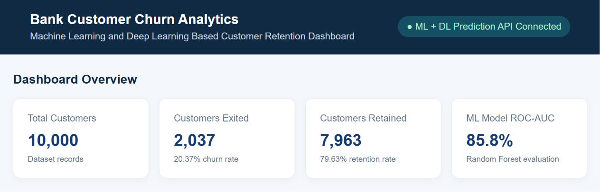
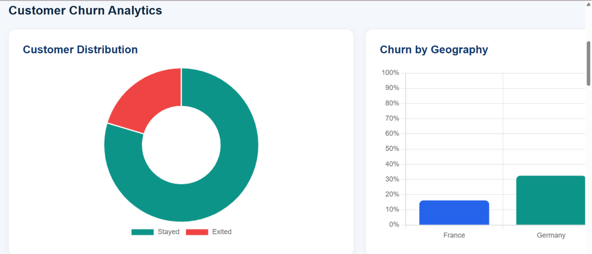
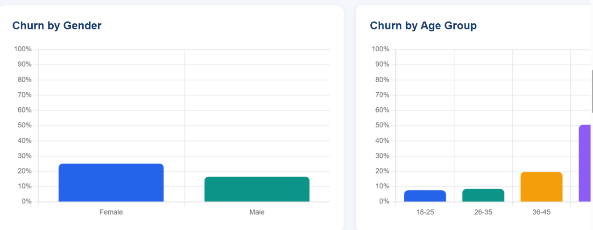
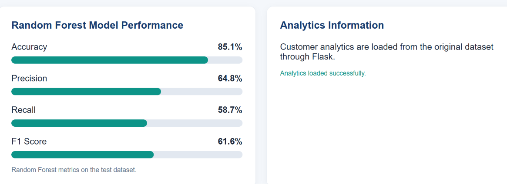
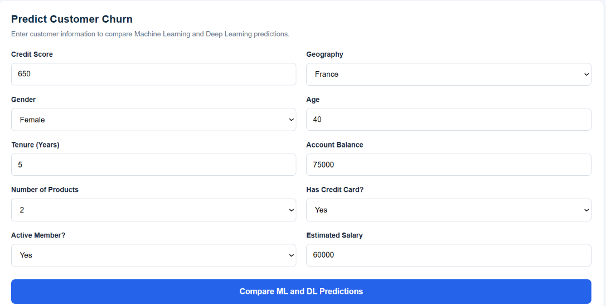
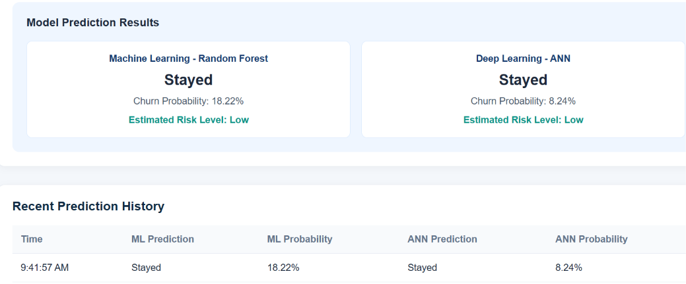

# Bank Customer Churn Prediction

An end-to-end Bank Customer Churn Prediction project using **Machine Learning, Deep Learning, and Flask**. The application analyzes customer information, predicts the likelihood of customer churn using two models, and displays interactive analytics through a web dashboard.

## Project Overview

Customer churn occurs when customers stop using a bank's services. Identifying customers who may leave helps banks understand customer behavior and plan customer-retention strategies.

This project uses customer data to:
- Analyze customer behavior and churn patterns.
- Train Machine Learning classification models.
- Develop a Deep Learning model using an Artificial Neural Network (ANN).
- Predict customer churn and estimate churn probability.
- Compare predictions from Machine Learning and Deep Learning models.
- Visualize customer analytics through an interactive web dashboard.

## Objectives

- Perform Exploratory Data Analysis (EDA).
- Identify patterns associated with customer churn.
- Preprocess customer data for model training.
- Build and evaluate Machine Learning models.
- Develop an ANN-based Deep Learning model.
- Integrate trained models with a Flask application.
- Provide real-time customer churn predictions through a web interface.

## Dataset

**Dataset:** Churn_Modelling.csv

The dataset contains:
- 10,000 customer records.
- 14 columns.
- Customer demographic, account, and banking information.
- Target column: `Exited`.

Target variable:
- `0` – Customer stayed.
- `1` – Customer exited.

The original dataset is preserved in the `dataset/` directory.

## Technologies Used

| Category | Technologies |
|---|---|
| Programming Language | Python |
| Data Analysis | Pandas, NumPy |
| Data Visualization | Matplotlib, Seaborn, Chart.js |
| Machine Learning | Scikit-learn |
| Deep Learning | TensorFlow, Keras |
| Backend | Flask |
| Frontend | HTML, CSS, JavaScript |
| Model Serialization | Joblib |
| Development Environment | Jupyter Notebook, VS Code |

## Exploratory Data Analysis

The project includes analysis of:
- Customer distribution.
- Churn and retention rates.
- Geography-wise churn.
- Gender-wise churn.
- Age-group churn.
- Customer account characteristics.

## Machine Learning Models

The following classification algorithms were trained and evaluated:

1. Logistic Regression
2. Decision Tree
3. Random Forest

### Final Machine Learning Model: Random Forest

| Evaluation Metric | Score |
|---|---:|
| Accuracy | 85.1% |
| Precision | 64.8% |
| Recall | 58.7% |
| F1 Score | 61.6% |
| ROC-AUC | 85.8% |

The trained Random Forest pipeline is saved and integrated into the Flask application.

## Deep Learning Model

An Artificial Neural Network (ANN) was developed using TensorFlow and Keras.

### ANN Architecture

- Input layer based on preprocessed customer features.
- Hidden layer with 64 neurons and ReLU activation.
- Dropout layer (0.3).
- Hidden layer with 32 neurons and ReLU activation.
- Dropout layer (0.2).
- Output layer with 1 neuron and sigmoid activation.

### Training Configuration

- Optimizer: Adam
- Loss Function: Binary Crossentropy
- Evaluation Metric: Accuracy
- Batch Size: 32
- Maximum Epochs: 50
- Early Stopping: Enabled

The ANN model and its preprocessing pipeline are saved in the `models/` directory.

## Application Features

- Interactive customer churn analytics dashboard.
- Total customer, exited customer, and retained customer statistics.
- Customer distribution visualization.
- Geography-wise churn analysis.
- Gender-wise churn analysis.
- Age-group churn analysis.
- Random Forest model performance display.
- Customer information input form.
- Machine Learning churn prediction.
- Deep Learning churn prediction.
- Churn probability for both models.
- Low, Moderate, and High estimated risk levels.
- Side-by-side ML and DL prediction comparison.
- Recent prediction history.

## Sample Prediction Results

The following results were obtained during manual application testing:

| Test Case | Random Forest | ANN |
|---|---|---|
| High-risk customer | Exited – 88.61% | Exited – 89.11% |
| Low-risk customer | Stayed – 6.90% | Stayed – 1.15% |
| Spain customer profile | Exited – 79.84% | Exited – 98.03% |

These examples demonstrate that both models can generate predictions through the application. They are sample predictions, not model evaluation scores.

## Project Structure

```text
Bank-Customer-Churn/
│
├── dataset/
│   └── Churn_Modelling.csv
│
├── notebooks/
│   ├── 01_Data_Exploration.ipynb
│   ├── 02_Machine_Learning.ipynb
│   └── 03_Deep_Learning.ipynb
│
├── models/
│   ├── bank_churn_pipeline.pkl
│   ├── bank_churn_pipeline_ml.pkl
│   ├── bank_churn_ann.keras
│   └── bank_churn_ann_preprocessor.pkl
│
├── reports/
│
├── static/
│
├── templates/
│   └── index.html
│
├── app.py
├── requirements.txt
└── README.md
```

## Installation and Setup

### 1. Clone the Repository

```bash
git clone <your-repository-url>
```

Navigate to the project directory:

```bash
cd Bank-Customer-Churn
```

### 2. Create a Virtual Environment

```bash
python -m venv venv
```

### 3. Activate the Virtual Environment

Windows PowerShell:

```powershell
.\venv\Scripts\Activate.ps1
```

### 4. Install Dependencies

```bash
pip install -r requirements.txt
```

## Run the Application

Start the Flask application:

```bash
python app.py
```

Open the following address in your browser:

http://127.0.0.1:5000/

Enter customer details and click **Compare ML and DL Predictions** to view the predictions from both models.

## API Endpoints

| Endpoint | Method | Description |
|---|---|---|
| `/` | GET | Dashboard homepage |
| `/health` | GET | API health check |
| `/analytics` | GET | Customer analytics data |
| `/predict` | POST | Generate ML and DL churn predictions |

## Model Integration

The Flask backend integrates:
- A trained Random Forest pipeline for Machine Learning predictions.
- A trained ANN model for Deep Learning predictions.
- The corresponding preprocessing pipeline for ANN input data.

Both models return a churn prediction and estimated churn probability.

## Future Improvements

- Improve model performance through hyperparameter tuning.
- Add more customer-retention insights.
- Store prediction history in a database.
- Add authentication for dashboard access.
- Deploy the application to a cloud platform.

## Disclaimer

The predictions are estimates generated by trained Machine Learning and Deep Learning models. They are not guarantees of future customer behavior and should not be treated as the sole basis for banking decisions.

---

**Developed as an end-to-end Machine Learning and Deep Learning project using Python and Flask.**


## 📸 Project Screenshots

### 1. Dashboard Overview


### 2. Customer Analytics


### 3. Gender and Age Group Analysis


### 4. Random Forest Model Performance


### 5. Customer Churn Prediction Form


### 6. ML and DL Prediction Results
.
